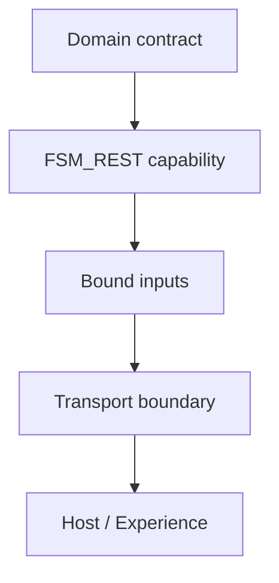
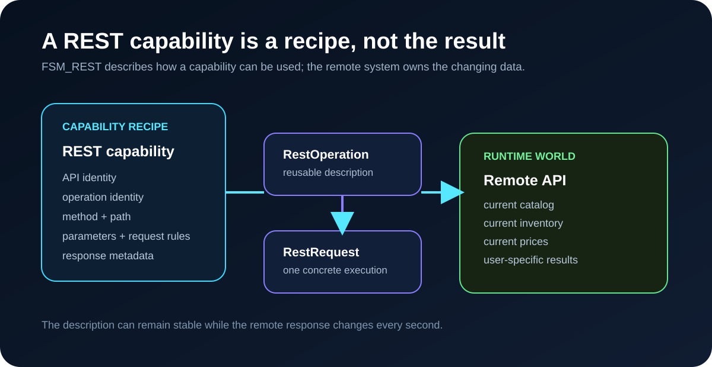
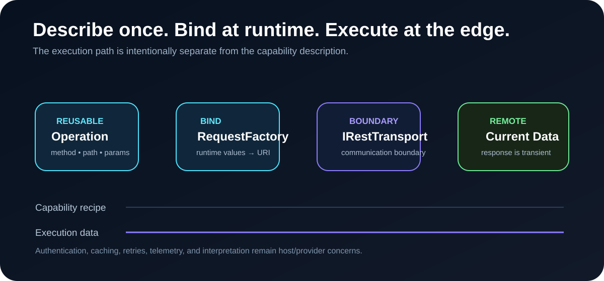
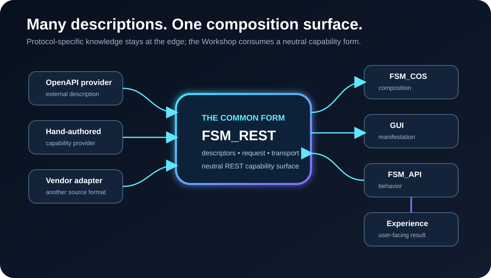

<!-- The Singularity Workshop moniker -->

**Maintainer:** @TrentBest · [Shared documentation standard](https://github.com/TrentBest/TheSingularityWorkshop.FSM_COS/blob/development/DOCUMENTATION_STANDARD.md) · [Living UML and data-card visual standard](https://github.com/TrentBest/TheSingularityWorkshop.FSM_COS/blob/development/docs/UML_VISUAL_STYLE.md)

# TheSingularityWorkshop.FSM_REST

## ✳️ 00 Identity

FSM_REST is the framework-neutral REST capability and transport substrate for The Singularity Workshop. It describes operations and constructs requests; it does not claim ownership of a remote API's domain behavior.

> **A reusable REST capability and transport substrate—not a REST API implementation.**

FSM_REST supplies the forms from which REST-facing capabilities can be composed. Its core directly consumes FSM_API and offers an opt-in FSM-backed request lifecycle; domain-specific MicroBundles still own the behavior and meaning of each capability.

## 🟦 01 What

It defines reusable capability and transport forms. It does not automatically implement every REST endpoint or own the domain rules behind a particular API.

## 🟣 02 Why

REST contracts, transport mechanics, and domain behavior change for different reasons. FSM_REST keeps the reusable capability and transport surface separate so an individual API's meaning and policy remain owned by its domain MicroBundle and host.

## 🩵 03 How

Define the capability boundary, bind the required inputs, and let the host decide how the transport is invoked. A response is data crossing the boundary; it is not automatically the capability itself.

## 🟢 04 See it in a minute

Run the [deterministic end-to-end demo](https://github.com/TrentBest/TheSingularityWorkshop.FSM_REST/blob/development/samples/RestCapabilityDemo/Program.md), then follow the capability recipe below. The demo uses a controlled in-memory HTTP handler, so it requires no live endpoint or credentials.

## 🟪 05 Choose your next step

[Start here: consumer guide](docs/CONSUMING.md) · [Architecture contract](docs/ARCHITECTURE.md) · [Release notes](docs/RELEASE_NOTES.md) · [Gallery: concepts, examples, visual provenance, and verification](https://github.com/TrentBest/TheSingularityWorkshop.FSM_REST/blob/development/Gallery.md) · [Capability recipe](#the-capability-recipe) · [Development](#development) · [License](#license)

---

## Detailed guide

**REST capability and transport substrate for the FSM ecosystem.**

FSM_REST is intentionally **not an implementation of a REST API**, and it is not a container for every REST description format.

It provides the reusable forms from which REST capabilities can be composed:

~~~text
REST MicroBundle / external description
            |
            v
        FSM_REST
            |
     +------+------+
     |             |
 capability     transport
 descriptors    boundary
     |             |
     +------+------+
            |
            v
     GUI / FSM / Experience
~~~

The important architectural rule is:

> **FSM_REST provides the composition surface. Domain and protocol-specific MicroBundles provide the things composed through it.**

  

## If you only have a minute

FSM_REST answers one question:

> **How does a REST capability enter the Workshop without bringing its entire description format, GUI, domain, or transport policy with it?**

The answer is a small neutral vocabulary for capability description, request construction, and transport.

---

## Explore a real-world composition

The [Walmart + Fred Meyer storefront sample](https://github.com/TrentBest/TheSingularityWorkshop.FSM_REST/blob/development/samples/StorefrontComparison/README.md) demonstrates one normalized shopping workflow over two provider adapters, using FSM_REST's transport boundary. It defaults to deterministic test responses, includes an opt-in read-only Fred Meyer/Kroger catalog call, and documents the partner-access boundary for Walmart's shopper APIs. It does not submit real orders.

## The capability recipe

The useful trick is that a REST API can be enormous at runtime while being small as a capability description.

**The MicroBundle stores what is needed to obtain the capability—not the remote payload itself.**

~~~text
CAPABILITY RECIPE
      │
      ▼
RestOperationDescriptor
      │
      │ bind runtime values
      ▼
RestRequest
      │
      ▼
IRestTransport
      │
      ▼
REMOTE API
      │
      │ current / user-specific data
      ▼
RestResponse
      │
      ▼
GUI / FSM / Experience
~~~

For a storefront, the bundle can carry the API identity, operation identity, method, path, parameter definitions, request rules, response metadata, and provider-specific behavior.

The current catalog, inventory, prices, user-specific results, and other changing payloads remain runtime data.

| Capability recipe | Runtime result |
|---|---|
| method + path | current records |
| parameters | current prices |
| request rules | current inventory |
| response metadata | current response |
| provider behavior | transient transport data |

**The response is runtime data. The MicroBundle is the capability recipe.**

This means an endpoint can be cheap to describe, distribute, compose, and replace without copying the dataset it exposes.

## Build a capability

The smallest useful REST capability is just an operation description:

~~~csharp
var operation = new RestOperationDescriptor(
    "GET",
    "/products",
    "listProducts",
    "List products",
    "Returns the current product catalog.",
    [
        new RestParameterDescriptor(
            "page", "query", false, "integer", null, "Page number.")
    ],
    null,
    [
        new RestResponseDescriptor(
            "200", "Product collection.",
            ["application/json"], "array", null)
    ]);

var api = new RestApiDescriptor(
    "Store Catalog",
    "1.0",
    [operation]);
~~~

Nothing has been fetched, cached, or rendered.

You have described a capability that can now participate in the Workshop.

## Bind and execute the capability

When an experience needs the data, the reusable capability is first bound to runtime values:

~~~csharp
var binding = new RestOperationBinding(
    operation,
    new Dictionary<string, string?> { ["page"] = "1" });

var request = RestRequestFactory.Create(
    binding,
    new Uri("https://example.test"));
~~~

The binding is one invocation. The operation descriptor remains reusable.

When an experience needs to send that request:

~~~csharp
using var httpClient = new HttpClient();
IRestTransport transport = new HttpClientRestTransport(httpClient);

var request = new RestRequest(
    "GET",
    new Uri("https://example.test/products?page=1"));

RestResponse response = await transport.SendAsync(request);

if (response.IsSuccessStatusCode)
{
    Console.WriteLine(response.Body);
}
~~~

The transport communicates.

It does not decide what the response means. Interpretation remains downstream.

  

## REST endpoint → MicroBundle

A provider can translate an external description into the neutral FSM_REST vocabulary and carry that capability as MicroBundle data.

~~~text
external description
        │
        ▼
provider / adapter
        │
        ▼
RestApiDescriptor
        │
   ┌────┼────┐
   ▼    ▼    ▼
 op A  op B  op C
   └────┼────┘
        ▼
 REST MicroBundle
        │
        ▼
    FSM_COS / host
        │
   ┌────┴────┐
   ▼         ▼
  GUI       FSM
   └────┬────┘
        ▼
    Experience
~~~

The optional `TheSingularityWorkshop.FSM_Rest.OpenApi` package provides `OpenApiJsonImporter` for an initial OpenAPI 3.x JSON subset, including supported local component references. `OpenApiRestApiConnection.ConnectAsync` can download a definition URL, choose a concrete declared server (or the definition origin), and execute imported operations by `operationId`. `RestResponse.Deserialize<T>()` deserializes JSON into a consumer-owned model; it does not perform API-schema validation.

`RestGuiMapping` connects an operation identity to renderer-neutral presentation metadata, GUI inputs, application-state source paths, and an optional result target. `RestGuiOperationExecutor` resolves mapped values through host-supplied callbacks, invokes the connected operation, and hands the response to the host's result publisher. The GUI adapter remains responsible for rendering controls, implementing state access, and applying authorization/error policy. YAML, external references, server-variable substitution, full schema semantics, and provider-specific behavior remain outside this initial implementation. Hand-authored descriptors and other provider adapters remain valid inputs.

**FSM_REST does not need to own every source format or domain-specific policy.**

When the REST capability itself needs to participate in FSM_COS, that integration lives in the separate `TheSingularityWorkshop.FSM_Rest.COS` package. The transport substrate remains independent.

  

See [REST Capability Model](docs/REFLECTION.md), [REST MicroBundles](docs/MICROBUNDLE.md), and [Theory](docs/THEORY.md).

## Why the response is not the bundle

The response is transient, changing, and often user-specific.

The bundle is reusable capability data.

~~~text
SMALL DESCRIPTION
      │
      │ method / path / parameters /
      │ request rules / response metadata
      ▼
REMOTE CAPABILITY
      │
      │ current state
      ▼
LARGE / DYNAMIC RESULT
~~~

This does not claim every REST integration is physically small. It means the bundle does not need to duplicate the remote dataset merely to describe how that dataset can be obtained.

That is the property that makes REST capabilities especially attractive as MicroBundle content.

## Transport boundary

Before transport, RestRequestFactory can bind operation parameters into a concrete request:

~~~csharp
var request = RestRequestFactory.Create(
    operation,
    new Uri("https://example.test/api"),
    new Dictionary<string, string?>
    {
        ["id"] = "42",
        ["page"] = "1"
    });
~~~

It handles path, query, header, and cookie parameter locations while leaving authentication, retries, caching, and transport policy outside the core. Missing keys and `null` mean absent; explicit empty query/header/cookie values are preserved where representable, while empty path values are rejected. Query plus signs are encoded as `%2B`, and duplicate/ambiguous parameter names fail fast. The optional OpenAPI importer warns when scalar binding cannot preserve array/object or style/explode semantics.

The package provides a minimal executable boundary:

~~~csharp
var request = new RestRequest(
    "POST",
    new Uri("https://example.test/users"),
    new Dictionary<string, string>
    {
        ["X-Trace"] = "trace-123"
    },
    "{\"name\":\"Ada\"}");

IRestTransport transport = new HttpClientRestTransport(httpClient);

RestResponse response = await transport.SendAsync(request);
~~~

IRestTransport is the important boundary. HttpClientRestTransport is merely one adapter.

That means a host can replace the HTTP implementation without changing the capability model.

## The operational theater

The intended direction is larger than an API client:

~~~text
external capability
        |
        v
MicroBundle / provider
        |
        v
   REST capability
        |
        +----------------+
        |                |
        v                v
      GUI              FSM behavior
        |                |
        +-------+--------+
                |
                v
           Experience
~~~

A REST operation can be mapped to a button, form, table action, detail view, workflow node, or another composition primitive. `RestGuiMapping` declares the operation, presentation hint, inputs and data paths, result target, and loading/error-state intent. A renderer-specific adapter chooses and builds the actual controls; FSM_REST remains GUI-framework-neutral.

## Relationship to the ecosystem

| Project | Responsibility |
|---|---|
| FSM_API | state-machine execution |
| MicroBundleDomain | domain-side MicroBundle description |
| FSM_COS | runtime MicroBundle composition |
| FSM_REST | REST capability and transport substrate |
| FSM_Rest.COS | optional REST-to-FSM_COS MicroBundle integration |
| FSM_Rest.OpenApi | optional OpenAPI JSON import and definition-URL connection |
| FSM_Serialization | serialized representation |
| GUI | visual manifestation |

Concrete protocol/domain packages remain separately owned and publishable. FSM_REST can also provide the small adapter needed when the REST capability itself is the MicroBundle.

## Alpha 5 boundary

**TheSingularityWorkshop.FSM_Rest 0.1.0-alpha.5**

Alpha 5 adds a direct `TheSingularityWorkshop.FSM_API` dependency and an opt-in FSM-governed REST transport lifecycle through `RestFsmExecutor`. The FSM tracks transport lifecycle (`Ready → Sending → Completed/Failed/Cancelled`); an HTTP non-success status remains a completed transport result rather than automatically becoming an FSM failure. Direct transport use remains available. Protocol-description importers and FSM_COS integration remain optional packages, keeping the core REST package independent of OpenAPI, GUI, MicroBundleDomain, and FSM_COS.

The optional OpenAPI package includes an initial OpenAPI 3.x JSON importer and a definition-URL connection path, but it is not a full OpenAPI runtime. The neutral core does not include protocol-description importers. It intentionally does **not** include:

- YAML parsing, external `$ref` resolution, server-variable substitution, or complete schema/composition validation;
- authentication implementations or credential acquisition;
- automatic GUI rendering or application-state path evaluation;
- concrete REST services or domain-specific MicroBundles.

Authentication, credential acquisition, concrete GUI rendering, application-state integration, concrete REST services, and domain-specific MicroBundles remain responsibilities of separate adapters or consuming applications.

## Documentation map

- [Gallery](https://github.com/TrentBest/TheSingularityWorkshop.FSM_REST/blob/development/Gallery.md) — implementation-grounded tour and verified boundaries.
- [Domain definition](docs/DOMAIN.md) — owned concepts, explicit non-goals, and package boundaries.
- [Theory](docs/THEORY.md) — why capability descriptions and runtime results are separate.
- [Reflection model](docs/REFLECTION.md) — descriptor semantics and execution flow.
- [MicroBundle integration](docs/MICROBUNDLE.md) — composition boundary and optional FSM_COS adapter.
- [Core UML and use cases](docs/UML/Architecture/FSM_REST.Core.UML.md) — source-grounded package relationships.
- [RestFsmExecutor type page](docs/RestFsmExecutor.md) and [UML/use cases](docs/UML/RestFsmExecutor.UML.md) — FSM_API-backed request lifecycle and verification limits.
- [RestOperationDescriptor class card](docs/UML/RestOperationDescriptor.UML.md) — focused class responsibilities and use cases.
- [Request execution UML](docs/UML/Architecture/RestRequestExecution.UML.md) — request construction, transport substitution, response handling, and test coverage.

## Development

~~~bash
dotnet restore TheSingularityWorkshop.FSM_REST.slnx
dotnet build TheSingularityWorkshop.FSM_REST.slnx --configuration Release
dotnet test tests/FSM_REST.Tests/FSM_REST.Tests.csproj --configuration Release
dotnet pack src/FSM_REST/FSM_REST.csproj --configuration Release --output ./artifacts
dotnet pack src/FSM_REST.OpenApi/FSM_REST.OpenApi.csproj --configuration Release --output ./artifacts
dotnet pack src/FSM_REST.COS/FSM_REST.COS.csproj --configuration Release --output ./artifacts
~~~

## License

MIT. See LICENSE.txt.

---

## 🔗 Resources & Support

### 📦 Related packages

- **Core NuGet:** [TheSingularityWorkshop.FSM_API](https://www.nuget.org/packages/TheSingularityWorkshop.FSM_API)
- **This Package:** [TheSingularityWorkshop.FSM_Rest](https://www.nuget.org/packages/TheSingularityWorkshop.FSM_Rest)
- **Source Code:** [TheSingularityWorkshop.FSM_REST on GitHub](https://github.com/TrentBest/TheSingularityWorkshop.FSM_REST)

### 💖 Support The Singularity Workshop

- **Patreon:** [Support us on Patreon](https://www.patreon.com/c/TheSingularityWorkshop)
- **PayPal:** [Make a donation](https://www.paypal.com/donate/?hosted_button_id=3Z7263LCQMV9J)

  <em>The Singularity Workshop — Tools for the curious, the bold, and the systemically inclined.</em> 
  <strong>Because state shouldn't be a mess.</strong>

---

<!-- THE SINGULARITY WORKSHOP FOOTER -->

   
  <strong>The Singularity Workshop</strong> 
  <em>If a picture is worth a thousand words, what is a living picture worth?</em> 
  <a href="https://github.com/TrentBest">GitHub</a> · <a href="https://www.patreon.com/TheSingularityWorkshop">Support the Workshop</a>

