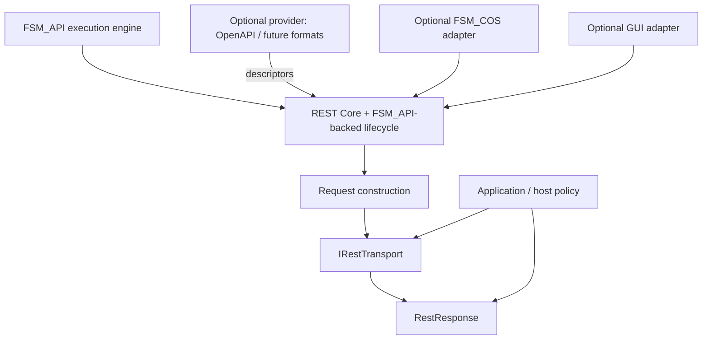

# FSM_REST Architecture Contract

**Owner / Workshop moniker:** @TrentBest  
**Status:** Working architecture contract; implementation and release readiness are verified separately.  
**Purpose:** Define the load-bearing boundaries that core, adapters, and provider packages must preserve.

## System responsibility

FSM_REST is a reusable REST capability substrate. It describes an operation, binds one invocation, constructs a request, delegates communication to a replaceable transport, and exposes the resulting response. It is not an API server, a protocol-description parser, a domain model, or a GUI.

## Dependency direction

- **Core owns:** API/operation/parameter/body/response descriptors, invocation binding, request construction, transport contract, HTTP transport adapter, and response envelope.
- **Optional provider owns:** external description formats, reference resolution, protocol-specific fidelity warnings, and format-specific connection helpers.
- **Optional integration owns:** translation into another subsystem contract, such as MicroBundleDomain or GUI node models.
- **Host owns:** credentials, authorization policy, retries, caching, rate limits, telemetry, server/environment choice, and application-specific interpretation unless a separate reusable policy package is justified.

Dependencies point inward toward the neutral model. Core must not depend on FSM_COS, GUI, OpenAPI, cloud services, or a concrete business API.

## Principal execution path

1. Describe a reusable operation in `RestOperationDescriptor`.
2. Bind invocation values with `RestOperationBinding`.
3. Construct a concrete `RestRequest` with `RestRequestFactory`; construction performs no network I/O.
4. Send via `IRestTransport`; the default HTTP adapter is `HttpClientRestTransport`.
5. Inspect `RestResponse` and interpret or deserialize it in the consuming domain/host.

## Contract invariants

- Descriptors are reusable metadata; invocation values and remote response data are runtime state.
- Request construction is deterministic for the same descriptor, binding, base URI, and explicit options.
- Unsupported or malformed inputs fail clearly rather than being silently discarded.
- The transport boundary is replaceable and supports cancellation.
- Response status, headers, and body are observations, not an assertion of success or schema validity.
- Optional packages must not leak their dependencies into core package metadata.
- A format importer must preserve supported semantics and surface unsupported semantics as warnings or explicit failures.

## Package map

| Package/project | Owns | Must not own |
|---|---|---|
| `src/FSM_REST` / `TheSingularityWorkshop.FSM_Rest` | Neutral descriptors, binding, request factory, transport, response, FSM_API-backed execution lifecycle | OpenAPI parser, COS, GUI, auth policy |
| `src/FSM_REST.OpenApi` / `TheSingularityWorkshop.FSM_Rest.OpenApi` | Initial OpenAPI 3.x JSON import and definition-URL connection | Core REST contracts, full conformance claims |
| `src/FSM_REST.COS` / `TheSingularityWorkshop.FSM_Rest.COS` | REST-to-MicroBundle adapter | Core transport/model ownership |
| `src/FSM_REST.GUI` | Optional GUI mapping adapter | Core REST dependency on GUI |
| `tests/FSM_REST.Tests` | Contract, boundary, regression, and integration tests | Claims based only on source-file or documentation counts |

## Verification levels

- **Unit:** deterministic tests for descriptors, binding, request construction, and response behavior.
- **Adapter contract:** tests for HttpClient transport and each optional adapter's behavior and failure paths.
- **Integration:** cross-package tests using fake transports or controlled handlers; live external services are not required for deterministic CI.
- **Package:** inspect IDs, versions, target frameworks, readme/license/XML docs, and dependency graphs.
- **Consumer proof:** a clean consumer restores the intended packages and executes the documented happy path.

The core package directly references `TheSingularityWorkshop.FSM_API` and exposes `RestFsmExecutor` as an opt-in FSM-governed execution path. The FSM tracks transport lifecycle (`Ready → Sending → Completed/Failed/Cancelled`); HTTP non-success status remains a completed transport result, not an FSM failure. Direct transport use remains available.

The repository's `scripts/check_architecture.py` is the CI guard for these package boundaries; it rejects core references to the OpenAPI, GUI-execution, and COS adapter types. A green build proves only the code and checks run by that workflow. It does not establish complete REST semantics, full OpenAPI conformance, production service reliability, or release approval.

## Near-term completion sequence

1. Preserve these dependency boundaries and keep the core independent.
2. Complete deterministic request/response/transport contract coverage, including cancellation, empty bodies, non-success statuses, malformed descriptors, and transport failures.
3. Make unsupported binding semantics explicit; never silently pretend arrays, objects, or OpenAPI style/explode are fully supported.
4. A deterministic sample now exercises descriptor → binding → request → controlled transport → response; keep it in CI as a consumer smoke test.
5. Verify optional package dependency graphs and consumer smoke tests in CI.
6. Update the domain gap assessment from observed evidence; defer nonessential protocol features until an actual consumer requires them.

This document defines the intended architecture. Source, tests, and the exact CI run determine what is implemented.
