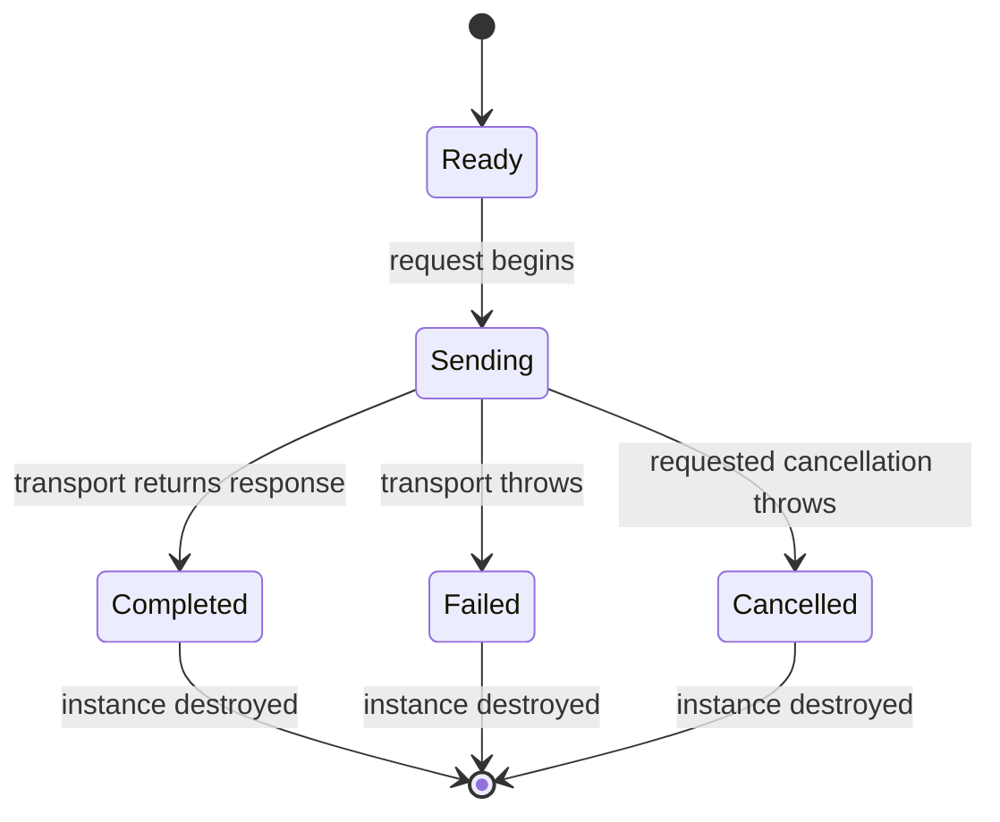

# RestFsmExecutor

**Owner / author:** Trent Best  
**Purpose:** Execute one REST request while using FSM_API to model that invocation's transport lifecycle.  
**Evidence:** Source-checked against `src/FSM_REST/RestFsmExecutor.cs` on `development`; this page is not a claim that the example was executed independently.  
**Related:** [Architecture contract](ARCHITECTURE.md) · [Gallery](../Gallery.md) · [UML and use cases](UML/RestFsmExecutor.UML.md)

## What it does

`RestFsmExecutor.SendAsync` is the opt-in FSM-governed alternative to calling `IRestTransport.SendAsync` directly. It creates a distinct FSM_API instance for each invocation, moves that instance through the transport lifecycle, returns the received `RestResponse`, and destroys the instance in a `finally` block.

The reusable definition is registered once by the class's static initializer. Each request gets its own `ExecutionContext` and instance handle; concurrent invocations therefore do not share the per-request target state.

## Lifecycle



The current implementation advances the FSM by updating the invocation context's `TargetState` and calling `handle.Update(ProcessingGroup)`. It checks that the handle reached `Sending` and `Completed`; a mismatch raises `InvalidOperationException`. The FSM definition's transition guards compare the requested target state with the transition destination.

## Important semantic boundary

- **Completed means the transport returned a response.** An HTTP 404 or 500 is not automatically an FSM failure; inspect `RestResponse.IsSuccessStatusCode` and the response content separately.
- **Failed means transport/execution threw an exception** on the normal send path.
- **Cancelled means an `OperationCanceledException` occurred while the supplied cancellation token was requested.** An unrelated cancellation exception follows the general failure path.
- The executor rethrows transport exceptions after recording the corresponding lifecycle state. It does not convert them into response objects.
- The instance is destroyed in `finally`; the state is an execution lifecycle, not a durable request history or telemetry store.
- The static FSM definition and processing group are registered by the class initializer. This is source behavior, not a claim about cross-process persistence.

## Usage

```csharp
using var client = new HttpClient();
IRestTransport transport = new HttpClientRestTransport(client);

RestResponse response = await RestFsmExecutor.SendAsync(
    request,
    transport,
    cancellationToken);

if (!response.IsSuccessStatusCode)
{
    // HTTP status is a response-level result, not a transport exception.
}
```

This snippet is **source-checked**, not independently executed as part of this document. The caller must supply an already constructed `RestRequest` and an `IRestTransport`.

## Verification still required

The repository's release checklist requires explicit lifecycle tests for normal completion, transport exceptions, requested cancellation, non-success HTTP statuses, concurrent invocations, and cleanup. The implementation file alone does not prove those paths pass tests. Use the current exact-SHA CI run as evidence before release.

## Dependencies

`TheSingularityWorkshop.FSM_Rest` directly references `TheSingularityWorkshop.FSM_API` version `1.0.13` in the current development project file. FSM_API owns the state-machine definition and instance lifecycle primitives; FSM_REST owns the REST-specific state names and the decision about what transport outcomes mean. FSM_REST core does not depend on FSM_COS.
