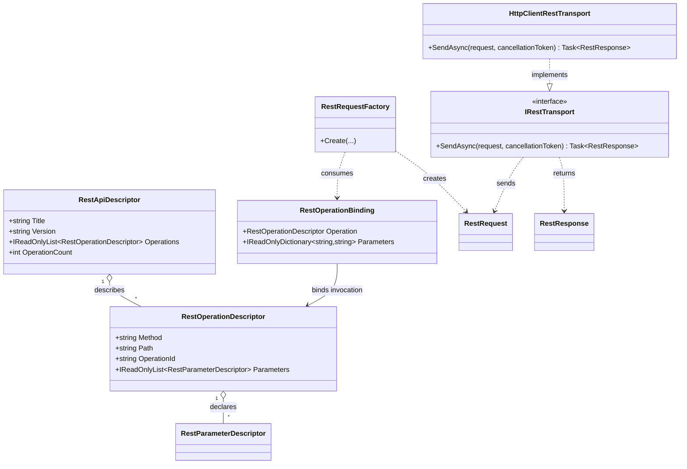

# FSM_REST Core — UML and Use Cases

**Target:** Core REST capability model and execution boundary.  
**Provenance:** Manually maintained, source-grounded conceptual UML; not generated.  
**Sources:** [Core project](../../../src/FSM_REST/FSM_REST.csproj), [request factory](../../../src/FSM_REST/RestRequestFactory.cs), [transport contract](../../../src/FSM_REST/IRestTransport.cs).

## Class diagram

## Use cases

### Describe a remote capability
A provider or application creates a `RestApiDescriptor` containing operation descriptors. The core does not require OpenAPI or any particular description format.

### Bind and construct an invocation
A caller supplies values through `RestOperationBinding`; `RestRequestFactory.Create` validates supported inputs and creates a request without network I/O.

### Execute through a replaceable transport
A host sends the request through `IRestTransport`, receives a `RestResponse`, and applies application-specific interpretation. Cancellation is passed through the transport contract.

### Compose with FSM_COS
The optional COS adapter translates a REST capability into a MicroBundle. The core does not depend on FSM_COS.

## Scope and verification

This view summarizes the neutral REST contracts and omits incidental members. It is not evidence of complete REST or OpenAPI semantics. Verify behavior with the repository tests and CI for the commit under review.
