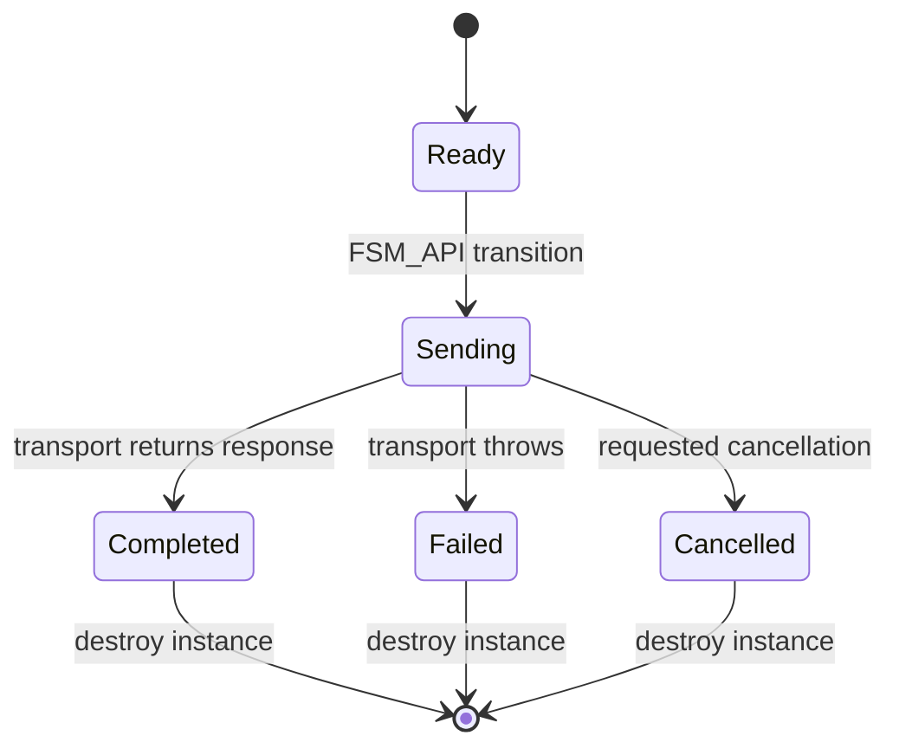

<!-- The Singularity Workshop moniker -->

# RestFsmExecutor — FSM-backed REST execution

**Target:** `TheSingularityWorkshop.FSM_REST.RestFsmExecutor`  
**Source:** [RestFsmExecutor.cs](../../../src/FSM_REST/RestFsmExecutor.cs)  
**Provenance:** Manually maintained, source-grounded diagram.

## Lifecycle diagram

## Responsibilities

- FSM_API owns the state transition mechanism.
- RestFsmExecutor owns the request/transport call and updates the lifecycle context.
- IRestTransport owns communication behavior.
- RestResponse preserves the HTTP status and payload.

## Use cases

1. **Track a request lifecycle.** Use `RestFsmExecutor.SendAsync` when the caller wants explicit FSM state progression around transport execution.
2. **Separate transport outcome from HTTP status.** A returned 404 reaches `Completed`; inspect `RestResponse.IsSuccessStatusCode` separately.
3. **Test failures without networking.** Inject an `IRestTransport` fake that returns a response or throws.

## Scope

The lifecycle is opt-in; direct transport calls remain supported. Authentication, retries, schema validation, and domain-level success criteria are not handled here.

<!-- THE SINGULARITY WORKSHOP FOOTER -->

