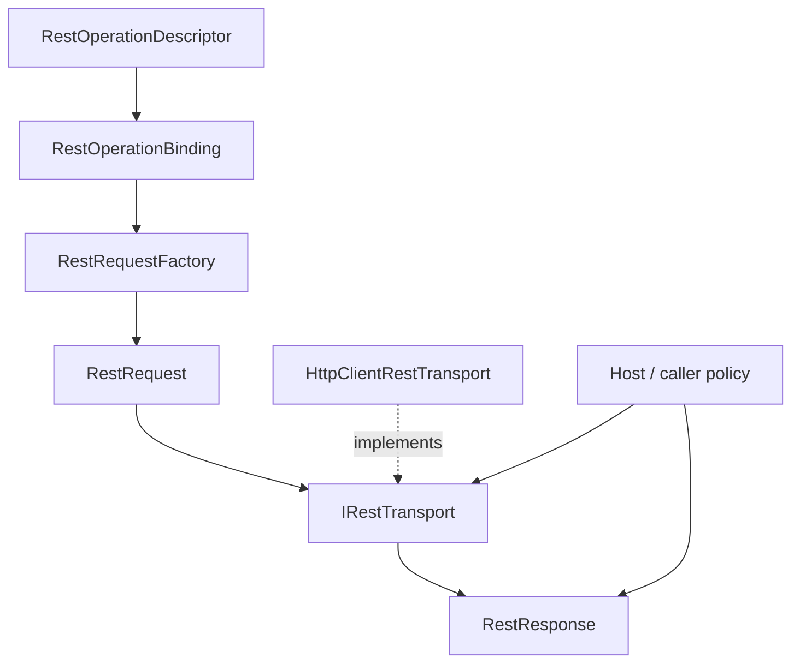

<!-- The Singularity Workshop moniker -->

# FSM_REST Request Execution UML

**Target:** Request construction and transport execution.  
**Provenance:** Source-grounded overview, manually maintained and not generated.  
**Source:** [Request construction](../../../src/FSM_REST/RestRequestFactory.cs), [transport contract](../../../src/FSM_REST/IRestTransport.cs), [HTTP adapter](../../../src/FSM_REST/HttpClientRestTransport.cs), [response envelope](../../../src/FSM_REST/RestResponse.cs).

## Execution path

## Responsibilities and invariants

- **`RestOperationDescriptor`** describes a reusable operation, not a request in flight.
- **`RestOperationBinding`** pairs the operation with values for one invocation.
- **`RestRequestFactory`** validates and composes a request; it performs no network I/O.
- **`IRestTransport`** defines the asynchronous send boundary and accepts a `CancellationToken`.
- **`HttpClientRestTransport`** adapts the contract to a host-supplied `HttpClient`.
- **`RestResponse`** preserves observed status, headers, and body. A non-2xx response is not automatically a transport exception.

## Use cases

### Construct without sending
Bind values and call `RestRequestFactory.Create`. This path is testable without networking.

### Substitute transport
A test or host can provide another `IRestTransport` without changing descriptors or request construction.

### Send and inspect
Call `SendAsync` with a cancellation token and inspect the returned `RestResponse`. Authentication, retries, payload interpretation, and other application policies remain explicit consumer concerns.

## Implementation and tests

- [Request factory](../../../src/FSM_REST/RestRequestFactory.cs)
- [Request contract](../../../src/FSM_REST/RestRequest.cs)
- [Transport contract](../../../src/FSM_REST/IRestTransport.cs)
- [HTTP adapter](../../../src/FSM_REST/HttpClientRestTransport.cs)
- [Response envelope](../../../src/FSM_REST/RestResponse.cs)
- [Transport tests](../../../tests/FSM_REST.Tests/RestTransportTests.cs)

This diagram explains boundaries; it does not substitute for test and CI evidence.

<!-- THE SINGULARITY WORKSHOP FOOTER -->

