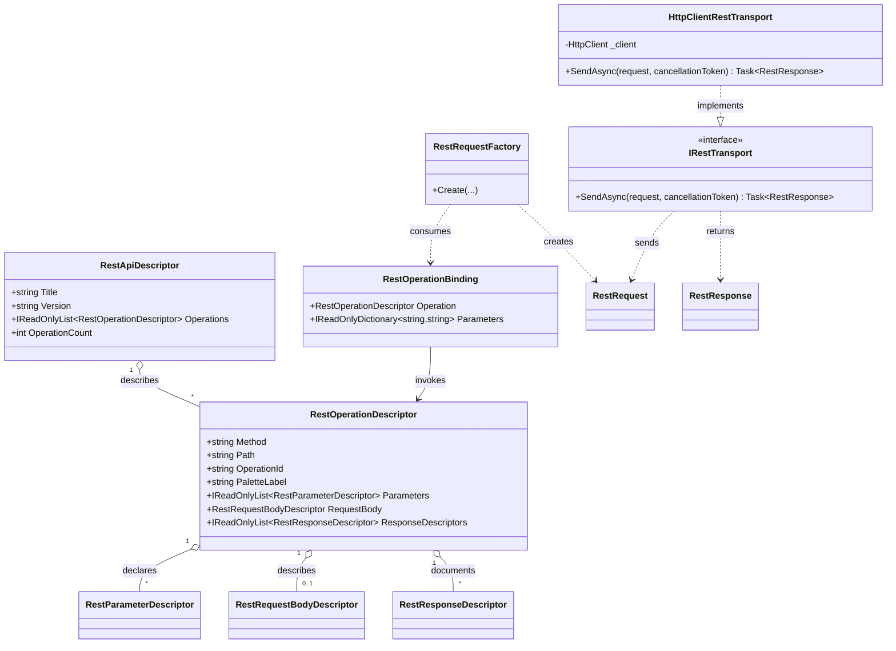

# FSM_REST Core — UML and Use Cases

## Class diagram

The central model is the operation descriptor. Runtime binding and request construction lead to the transport boundary; HTTP is one implementation of that boundary.

## Use cases

### UC-1 — Describe a remote capability

A provider or application creates a `RestApiDescriptor` containing operation descriptors. It need not use OpenAPI or any particular source format.

### UC-2 — Construct an invocation

A caller supplies runtime values through `RestOperationBinding` and invokes `RestRequestFactory.Create`. The factory validates required inputs and supported parameter locations and returns a request. No network call occurs during construction.

### UC-3 — Execute through HTTP

A host configures and owns an `HttpClient`, wraps it in `HttpClientRestTransport`, and calls `SendAsync`. Cancellation flows through the transport. The returned `RestResponse` is an observation, not a domain interpretation.

### UC-4 — Substitute a test or custom transport

A test or host implements `IRestTransport`. Capability descriptors and request construction remain independent of the concrete communication mechanism.

### UC-5 — Compose with FSM_COS

A consumer referencing the optional adapter constructs `RestMicroBundle` from a `RestApiDescriptor`. Core REST consumers do not need the FSM_COS adapter.

## Relationship and scope notes

- The diagram is a source-grounded conceptual UML view, not generated reflection output.
- It omits constructor overloads and incidental members to keep the architecture readable.
- The core project is `src/FSM_REST/FSM_REST.csproj`; the root web project is a non-packable experimental host.
