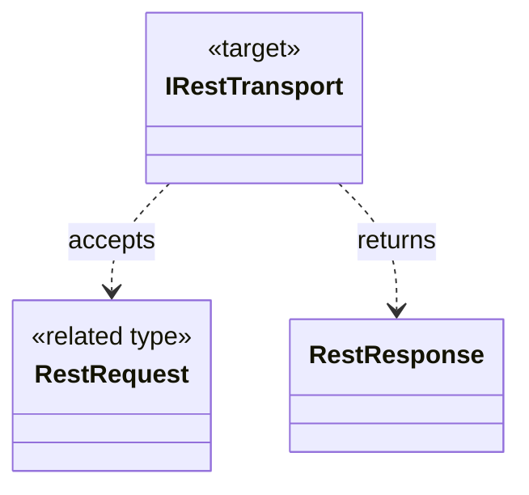

# IRestTransport — UML and Use Cases

**Author / Workshop moniker:** @TrentBest  
**Target:** `TheSingularityWorkshop.FSM_REST.IRestTransport`  
**Source:** [IRestTransport.cs](../../src/FSM_REST/IRestTransport.cs)  
**Provenance:** Manually authored and source-checked; not generated by AST, reflection, or GUI.SVG.

## Purpose
Define a replaceable asynchronous request/response communication boundary.

## Target-centered class diagram

The diagram is deliberately focused on the target and its direct architectural relationships. It omits incidental members and does not claim to enumerate every repository consumer.

## Use cases
1. **A host injects an implementation into execution**
2. **Respect the boundary.** Use this type for its declared role; do not infer network behavior, authorization, schema validation, or runtime rendering unless explicitly implemented by the related component.

## Verification and limits
- Source: [IRestTransport.cs](../../src/FSM_REST/IRestTransport.cs)
- Related UML: [core architecture](FSM_REST.Core.UML.md) and [UML index](README.md)
- Tests: [FSM_REST tests](../../tests/FSM_REST.Tests/)
- Re-check the diagram when public members, dependency relationships, or behavior change.
