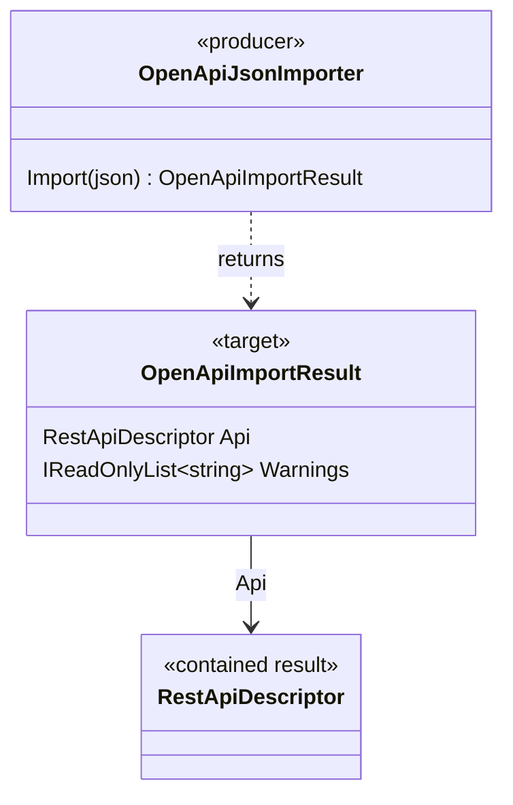

# OpenApiImportResult — UML and Use Cases

**Author / Workshop moniker:** @TrentBest  
**Target:** `TheSingularityWorkshop.FSM_REST.OpenApi.OpenApiImportResult`  
**Source:** [OpenApiJsonImporter.cs](../../src/FSM_REST.OpenApi/OpenApiJsonImporter.cs)  
**Provenance:** Manually authored and checked against the declared record; not generated.

## Purpose

Carry the neutral API descriptor produced by `OpenApiJsonImporter.Import` together with warnings about unsupported or unresolved OpenAPI constructs.

## Target-centered class diagram

The diagram shows the importer/result contract, not every internal parsing helper or every possible OpenAPI construct.

## Use cases

1. **Review import fidelity.** Read `Warnings` before relying on an imported descriptor, especially when the source document uses security requirements or unsupported serialization/schema features.
2. **Continue with normalized metadata.** Pass `Api` to code that consumes FSM_REST descriptors; importing does not itself execute HTTP requests.
3. **Keep responsibilities separated.** The result reports information; it does not resolve authentication, validate response bodies against schemas, or guarantee remote API availability.

## Verification and provenance

- Source: [OpenApiJsonImporter.cs](../../src/FSM_REST.OpenApi/OpenApiJsonImporter.cs), where this public record is declared alongside the importer.
- Related UML: [OpenApiJsonImporter](OpenApiJsonImporter.UML.md), [RestApiDescriptor](RestApiDescriptorUML.md), and [UML index](README.md).
- Tests: [OpenAPI importer tests](../../tests/FSM_REST.Tests/OpenApiJsonImporterTests.cs).
- Manually authored; no AST/reflection generation or runtime capture is claimed.
