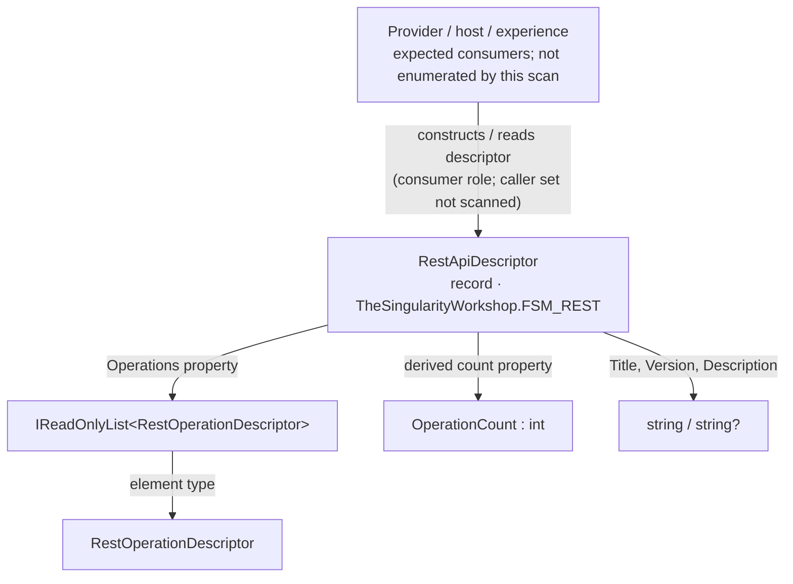

# RestApiDescriptor — target-centered UML and use cases

> **Status:** Source-checked structural guide; not generated.  
> **Target:** `TheSingularityWorkshop.FSM_REST.RestApiDescriptor`  
> **Source:** [`RestApiDescriptor.cs`](../../src/FSM_REST/RestApiDescriptor.cs) on `development`.  
> **Scope:** The target declaration and its direct visible type references. Consumers are not exhaustively scanned.

## Plain-language purpose

A `RestApiDescriptor` is a reusable description of a REST API: its title, version, optional description, and the operations it offers. It describes a capability; it does not send HTTP requests, authenticate, discover an API description, or create a user interface.

Think of it as a menu that describes what can be ordered, not the order itself and not the kitchen that fulfills it. The analogy ends there: the descriptor is a typed .NET record, not a restaurant workflow or a guarantee that a remote endpoint exists.

## Target-centered structural view

**Relationship legend:** the upper arrow expresses the expected role of consumers; no repository-wide caller scan was performed. The lower arrows reflect the record's declared properties and derived `OperationCount`. They do not imply execution order or guarantee that an operation is callable.

## Public contract and boundaries

The record declares:

- `Title` and `Version`: human-readable API identity supplied by the capability owner.
- `Operations`: a read-only list of `RestOperationDescriptor` values.
- `Description`: optional explanatory text.
- `OperationCount`: a derived count of `Operations.Count`.

An operation's method, path, identity, parameter definitions, body metadata, and response metadata are described by [`RestOperationDescriptor`](../../src/FSM_REST/RestOperationDescriptor.cs). Request binding and construction are separate steps; sending happens through `IRestTransport`. The optional FSM_COS integration is kept in the separate [`FSM_REST.COS` project](../../src/FSM_REST.COS/).

## Use cases

1. **Describe a capability for a catalog or palette.** Create a descriptor containing the operations that a provider has translated into the neutral REST model.
2. **Keep description separate from execution.** Reuse the descriptor while creating a new `RestOperationBinding` and `RestRequest` for each invocation.
3. **Swap transport implementations.** Preserve the descriptor contract while a host chooses `HttpClientRestTransport` or another `IRestTransport`.
4. **Compose into FSM_COS when needed.** Use the optional `RestApiDescriptor.ToMicroBundle(...)` extension from the separate integration package; the core descriptor does not require FSM_COS.

## Verification and provenance

- Source: [`RestApiDescriptor.cs`](../../src/FSM_REST/RestApiDescriptor.cs), [`RestOperationDescriptor.cs`](../../src/FSM_REST/RestOperationDescriptor.cs), and [integration extension](../../src/FSM_REST.COS/RestApiDescriptorExtensions.cs).
- Explanation: [REST capability model](../REFLECTION.md), [MicroBundle theory](../MICROBUNDLE.md), and [Gallery](../../Gallery.md).
- Run the repository tests with `dotnet test tests/FSM_REST.Tests/FSM_REST.Tests.csproj --configuration Release`.
- This page is manually authored from source; it is not generated by GUI.SVG, AST analysis, or reflection, and it is not runtime evidence.
- No full consumer scan was performed. Future generated diagrams should state scan scope, preserve stable identities and source locations, distinguish relationship types, and mark unresolved references instead of guessing.
