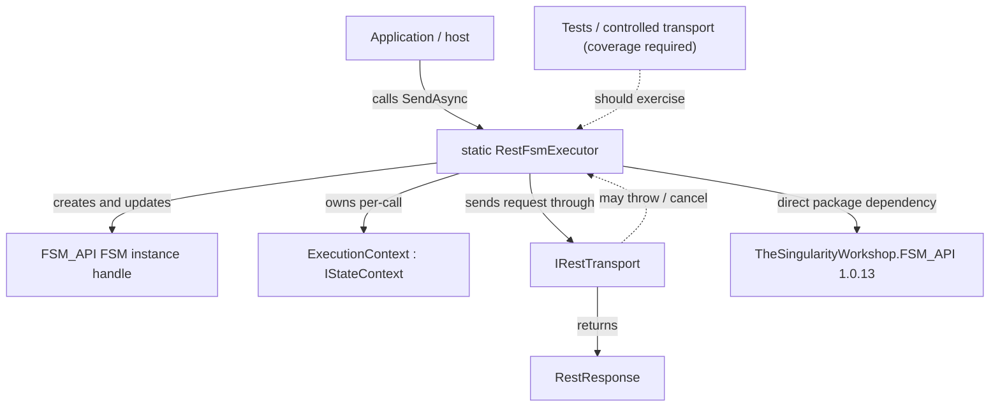
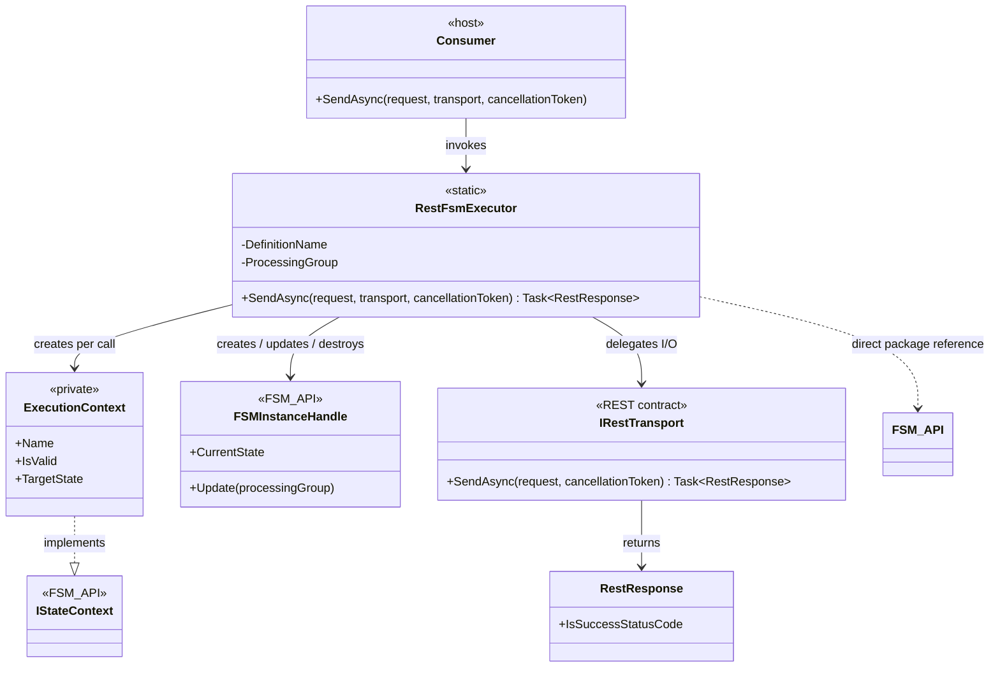

# RestFsmExecutor — UML Class Card

**Owner / author:** Trent Best  
**Purpose:** Record the per-request transport lifecycle through FSM_API without confusing transport completion with HTTP business success.  
**Source:** [RestFsmExecutor.cs](../src/FSM_REST/RestFsmExecutor.cs).  
**Provenance:** Source-checked manually against `src/FSM_REST/RestFsmExecutor.cs` on `development`; not generated, not runtime-captured.  
**Scan scope:** One source file plus the direct FSM_API package reference in `src/FSM_REST/FSM_REST.csproj`. This is not a repository-wide caller search.

## Target-centered neighborhood

## Class card

The exact FSM_API handle type is intentionally shown as a conceptual role here rather than a guessed fully qualified class name. Confirm it against the referenced API source before replacing this label with a concrete declaration.

## Responsibilities

- Register the shared `TheSingularityWorkshop.FSM_REST.Execution` definition in the `FSM_REST` processing group.
- Define `Ready`, `Sending`, `Completed`, `Failed`, and `Cancelled` states and guarded transitions.
- Create a separate context and instance for each request.
- Record transport outcome, preserve the returned response, rethrow transport exceptions even if terminal-state recording fails, and destroy the instance in `finally`.

## Non-responsibilities

- Does not create the `RestRequest`; request construction remains separate.
- Does not decide whether an HTTP status is a business success.
- Does not provide durable history, retries, authentication, caching, or telemetry.
- Does not depend on FSM_COS or compose MicroBundles.

## Use cases

### 1. Observe a successful transport lifecycle

- **Actor:** Application or host.
- **Goal:** Send a prepared request while modeling execution with FSM_API.
- **Trigger/preconditions:** A non-null `RestRequest`, a non-null `IRestTransport`, and optional cancellation token.
- **Expected outcome:** FSM moves `Ready → Sending → Completed`; the transport response is returned.
- **Alternative:** An HTTP non-success status is still a completed transport result; the caller interprets the response.
- **Evidence:** Source-checked in `RestFsmExecutor.SendAsync`; test execution must be confirmed from current CI.

### 2. Record transport failure

- **Actor:** Application or host.
- **Goal:** Preserve the original exception while attempting to mark the FSM lifecycle as failed.
- **Trigger:** Transport throws an exception other than a requested cancellation.
- **Expected outcome:** The executor requests `Failed`, updates the FSM, and rethrows; the handle is destroyed in `finally`.
- **Failure caveat — lifecycle recording:** Source catches an exception from terminal-state recording and attempts to attach it to the original transport exception's `Data` under `FSM_REST.LifecycleRecordingException`. If writing to `Exception.Data` itself fails, the original transport exception is still preserved.
- **Failure caveat — cleanup:** If `DestroyInstance` throws while another operation exception is already propagating, the cleanup exception is attached separately under `FSM_REST.CleanupException` so it does not replace the primary exception. If cleanup is the only failure after an otherwise successful operation, the cleanup exception surfaces to the caller.
- **Test gap:** Neither secondary-exception path currently has deterministic fault-injection coverage. The five executor tests cover normal response, transport failure, requested cancellation, unsolicited cancellation, and overlapping calls only.
- **Evidence:** These exception-preservation behaviors are source-checked, not independently executed or CI-verified at the current branch head.

### 3. Record requested cancellation

- **Actor:** Application or host.
- **Goal:** Distinguish caller-requested cancellation from other transport failures.
- **Trigger:** Transport throws `OperationCanceledException` while the supplied token is cancellation-requested.
- **Expected outcome:** The executor requests `Cancelled`, updates the FSM, and rethrows the cancellation exception.
- **Alternative:** An `OperationCanceledException` with no requested cancellation token follows the general failure path.
- **Evidence:** Source-checked; test execution must be confirmed from current CI.

## Package references and evidence limits

The current project file directly references `TheSingularityWorkshop.FSM_API` `1.0.13`. The current analysis scope does not establish every caller in the repository, nor does this manually authored diagram prove runtime behavior. The release gate should require lifecycle tests and exact-SHA CI evidence.
