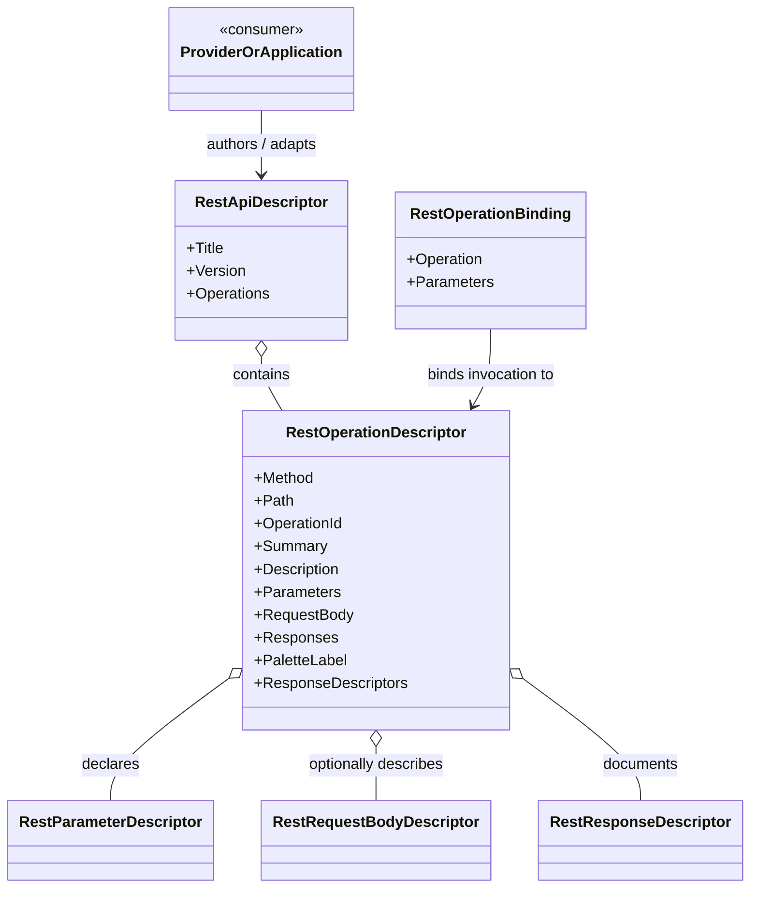

# RestOperationDescriptor — UML Class Card

**Owner / author:** Trent Best  
**Purpose:** Describe one reusable REST operation capability without binding it to a specific API-description format, transport implementation, GUI, or domain.

## Class card

## Responsibilities

- Store operation metadata: method, relative path, operation identity, human-readable text, parameters, optional body description, and response descriptions.
- Provide a simple downstream label through `PaletteLabel`.
- Expose response metadata through `ResponseDescriptors`, returning an empty collection when no response descriptors were supplied.

## Non-responsibilities

This record does not parse external documents, bind runtime parameter values, construct a request, send network traffic, authenticate, cache, or interpret response data.

## Use cases

1. **Provider translation:** map an external description or authored capability into a stable neutral operation representation.
2. **Capability palette:** provide a concise display label without making the descriptor depend on GUI code.
3. **Invocation:** pair the reusable descriptor with runtime values using `RestOperationBinding`.
4. **Inspection:** allow downstream composition layers to inspect request and response metadata before execution.

## Source

[RestOperationDescriptor.cs](../../src/FSM_REST/RestOperationDescriptor.cs)
