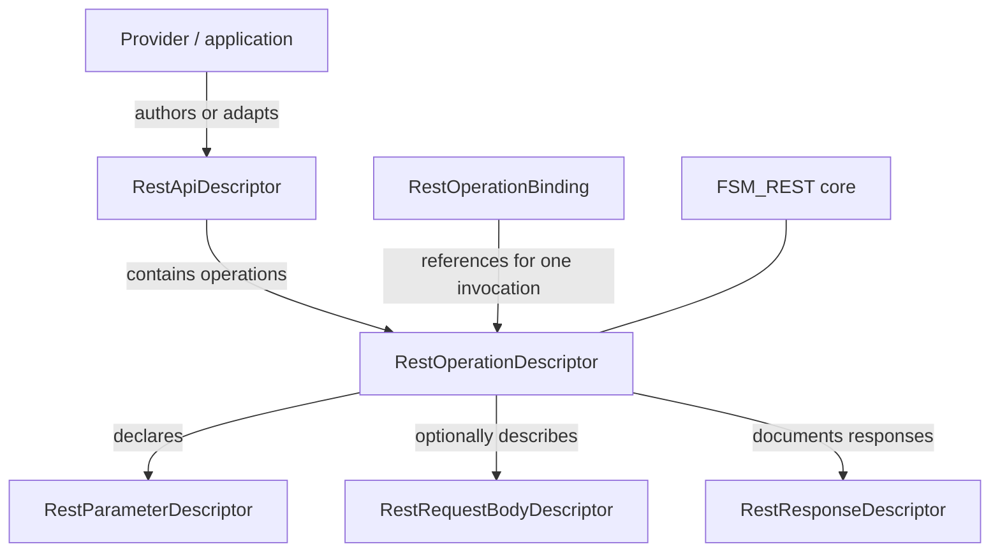
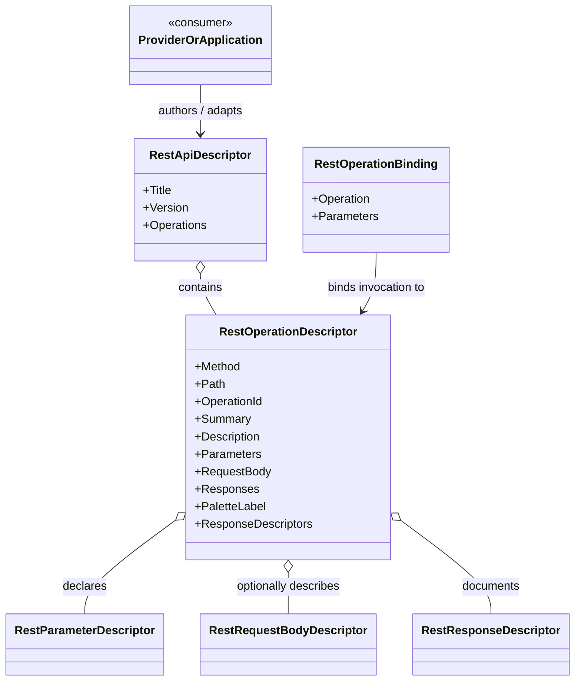

<!-- The Singularity Workshop moniker -->

# RestOperationDescriptor — UML Class Card

**Owner / author:** Trent Best  
**Purpose:** Describe one reusable REST operation capability without binding it to a specific API-description format, transport implementation, GUI, or domain.  
**Source:** [RestOperationDescriptor.cs](../../src/FSM_REST/RestOperationDescriptor.cs).  
**Provenance:** Source-checked manually; not generated or runtime-captured.  
**Scan scope:** The target declaration and directly related descriptor/binding types shown below; not a repository-wide consumer scan.

## Target-centered neighborhood

## Class card

## Responsibilities

- Store operation metadata: method, relative path, operation identity, human-readable text, parameters, optional body description, and response descriptions.
- Provide a concise downstream label through `PaletteLabel`.
- Expose response metadata through `ResponseDescriptors`, returning an empty collection when no response descriptors were supplied.

## Non-responsibilities

This record does not parse external documents, bind runtime parameter values, construct a request, send network traffic, authenticate, cache, or interpret response data.

## Use cases

### 1. Translate a provider capability

- **Actor:** Provider adapter or application author.
- **Goal:** Represent an operation in the neutral FSM_REST model.
- **Trigger/preconditions:** An authored or imported operation description is available.
- **Expected outcome:** An operation descriptor carries method, path, identity, parameter metadata, optional request-body metadata, and response descriptions.
- **Alternative:** Unsupported source-format details must be handled or reported by the importing adapter; this descriptor does not preserve every external format feature by itself.
- **Evidence:** Source-checked; importer behavior must be verified against its own tests.

### 2. Bind an invocation

- **Actor:** Request-building layer.
- **Goal:** Pair reusable operation metadata with values for one call.
- **Trigger/preconditions:** A descriptor and invocation parameter values are available.
- **Expected outcome:** A separate `RestOperationBinding` represents that invocation without mutating the reusable descriptor.
- **Evidence:** Source-checked; request construction and transport are separate responsibilities.

### 3. Inspect operation metadata

- **Actor:** Consumer, palette, or composition layer.
- **Goal:** Inspect the operation contract before creating a request.
- **Expected outcome:** Downstream code can read operation identity, parameters, body description, and response metadata without depending on a GUI or transport implementation.
- **Evidence:** Source-checked; a class diagram does not establish runtime behavior.

## Source and related documentation

- [RestOperationDescriptor.cs](../../src/FSM_REST/RestOperationDescriptor.cs)
- [FSM_REST Gallery](../../Gallery.md)
- [Architecture contract](../ARCHITECTURE.md)

<!-- THE SINGULARITY WORKSHOP FOOTER -->

