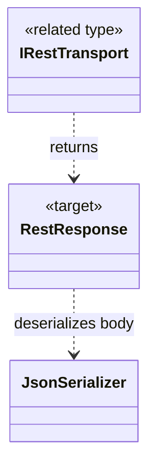

<!-- The Singularity Workshop moniker -->

# RestResponse — UML and Use Cases

**Author / Workshop moniker:** @TrentBest  
**Target:** `TheSingularityWorkshop.FSM_REST.RestResponse`  
**Source:** [RestResponse.cs](../../src/FSM_REST/RestResponse.cs)  
**Provenance:** Manually authored and source-checked; not generated by AST, reflection, or GUI.SVG.

## Purpose
Represent observed status, headers and body, with a convenience JSON deserializer into a consumer-owned type.

## Target-centered class diagram

The diagram is deliberately focused on the target and its direct architectural relationships. It omits incidental members and does not claim to enumerate every repository consumer.

## Use cases
1. **Caller inspects status and body**
2. **Respect the boundary.** Use this type for its declared role; do not infer network behavior, authorization, schema validation, or runtime rendering unless explicitly implemented by the related component.

## Verification and limits
- Source: [RestResponse.cs](../../src/FSM_REST/RestResponse.cs)
- Related UML: [core architecture](Architecture/FSM_REST.Core.UML.md) and [UML index](README.md)
- Tests: [FSM_REST tests](../../tests/FSM_REST.Tests/)
- Re-check the diagram when public members, dependency relationships, or behavior change.

<!-- THE SINGULARITY WORKSHOP FOOTER -->

