<!-- The Singularity Workshop moniker -->

# Chapter 1 — From Resources to Representations

**Maintainer:** @TrentBest  
**Chapter type:** Conceptual textbook chapter

## 01 — What: a resource is not a response body

Imagine a university course catalog. A course has an identity, such as CS101. Its current representation might include a title, instructor, schedule, and enrollment status. Those fields can change without the conceptual resource becoming a different thing.

REST—Representational State Transfer—is an architectural style for networked systems. HTTP is a protocol often used to implement REST-style interfaces. JSON is one possible representation format. These ideas are related, but they are not synonyms:

- **Resource:** the conceptual thing identified by the interface.
- **Identifier:** a URI used to refer to a resource or target.
- **Representation:** a transferable description of resource state in an agreed format.
- **HTTP request:** a method, target URI, headers, and optionally content.
- **HTTP response:** status, headers, and optionally content, sent in reply to a request.

A library catalog entry is not the book itself, and a JSON document describing that entry is not the entry itself. It is a representation that a client interprets.

<figure>
  
  <figcaption>Conceptual illustration, not a packet capture.</figcaption>
</figure>

## 02 — Why: separate identity from a particular view

If a client treats one response body as the resource itself, it may confuse a temporary view with durable identity. A response may omit fields due to permissions, content negotiation, server policy, or API version. A later response can represent the same resource differently.

The separation lets a server change representation details without requiring every consumer to treat every payload as a new domain object. Status codes communicate request outcomes; headers carry metadata; the body, if present, contains content to interpret.

Not every HTTP API is RESTful in the strict architectural sense. An endpoint can use HTTP and JSON while ignoring REST constraints. In everyday engineering, “REST API” is often used more loosely for a resource-oriented HTTP API. Be explicit about which meaning a course or review uses.

## 03 — How: read a request as a contract

An illustrative request:

~~~http
GET /courses/CS101 HTTP/1.1
Accept: application/json
~~~

The method expresses the requested operation; the target identifies what is addressed; Accept communicates a preferred response representation. The server decides what response is appropriate under its contract.

These are separate questions:

1. Is the URI syntactically valid?
2. Does the target identify a resource understood by the server?
3. Is the method supported for that target?
4. Is the caller authorized?
5. Did the server produce a response?
6. Can the client parse and interpret it?
7. Does it satisfy the consumer's domain expectations?

A successful answer to one question does not prove the others.

## 04 — See it in a minute

Use the [FSM_REST capability demo](../../samples/RestCapabilityDemo/Program.md). It builds a request and runs against a controlled in-memory HTTP handler, so the lesson does not depend on credentials or a live third-party API.

In FSM_REST, RestOperationDescriptor describes an operation, RestRequest is the concrete invocation, IRestTransport sends it, and RestResponse carries the result. The descriptor is not a cached response and does not own the remote resource.

## 05 — Choose your next step

- Continue to [Chapter 2 — The network is a boundary](Chapter-02-The-Network-Boundary.md).
- Read the package [theory](../THEORY.md) and [consumer guide](../CONSUMING.md).
- Discussion: if a response body changes shape while resource identity remains stable, which part of the client contract should change—and which should not?

---

