<!-- The Singularity Workshop moniker -->

# Chapter 2 — The Network Is a Boundary

**Maintainer:** @TrentBest  
**Chapter type:** Conceptual textbook chapter

## 01 — What: a remote call is an uncertain exchange

A local method call normally returns, throws, or continues until the process is interrupted. A network call adds uncertainty between caller and receiver. Requests and responses may be delayed, lost, rejected, or rendered unusable by a connection failure. A caller can time out without knowing whether the server completed the operation.

**A timeout is evidence that the caller did not observe a timely result; it is not proof that the server did nothing.**

<figure>
  
  <figcaption>Conceptual failure model, not a measurement from a live network.</figcaption>
</figure>

## 02 — Why: failures change the meaning of control flow

Suppose a client asks to create an order. The server creates it, but the response is lost. The client times out and retries. If the operation is not designed for safe repetition, the result may be two orders.

Retry policies cannot be selected from HTTP status alone. Consider:

- **Operation semantics:** is repeating the request safe?
- **Idempotency:** does repetition produce the same intended effect?
- **Failure class:** was there a response, a connection failure, or a timeout?
- **Budget:** how many attempts and how much total time are allowed?
- **Load:** could retries amplify an overloaded service?
- **Cancellation:** what client-side work observes cancellation, and what remote effects may already have committed?

HTTP defines method semantics, but applications must still implement endpoint behavior correctly. Even an idempotent operation can produce repeated logs, billing, or notifications if implemented carelessly.

## 03 — How: establish explicit boundaries

| Concern | A responsible contract says | It must not imply |
|---|---|---|
| Timeout | How long the caller waits before giving up | The server stopped at that instant |
| Cancellation | Which client-side work observes the token | Already-committed effects are rolled back |
| Retry | Which operations and failures may be retried | Every failure is transient |
| Idempotency key | How repeated requests are recognized, if supported | The server honors the key unless verified |
| Response parsing | Which media types and payload forms are accepted | Valid JSON is valid domain data |
| Error handling | How statuses and transport failures reach the caller | Every non-2xx response is automatically an exception |

Before retrying, ask: **Could the first attempt have taken effect?** If yes, a safe strategy may require an idempotent operation, a server-supported idempotency key, reconciliation, or no automatic retry.

Backoff and jitter can reduce synchronized retry storms, but do not make an unsafe operation safe. A circuit breaker can reduce repeated calls to an unhealthy dependency, but it does not repair the dependency or guarantee fallback correctness.

## 04 — See it in a minute

In FSM_REST, IRestTransport is the communication boundary and its asynchronous contract accepts cancellation. HttpClientRestTransport is one adapter. The core should not silently claim retry, caching, authentication, circuit breaking, or remote transaction rollback when those policies are not part of the implementation.

Study the deterministic cases in tests/FSM_REST.Tests/RestTransportTests.cs, including cancellation and response handling. Tests establish those cases, not every possible network failure.

## 05 — Choose your next step

- Continue to [Chapter 3 — Capability, recipe, execution, result](Chapter-03-Capability-Recipe-Execution.md).
- Read the [execution contract](../THEORY.md#execution-contract-what-each-stage-guarantees).
- Exercise: design a retry policy for GET /courses/CS101, then compare it with POST /orders. List the server assumptions your policy requires.

---

