<!-- The Singularity Workshop moniker -->

# Chapter 3 — Capability, Recipe, Execution, Result

**Maintainer:** @TrentBest  
**Chapter type:** Conceptual textbook chapter

## 01 — What: describe how to obtain a capability

A remote API can expose hundreds of operations and return enormous, changing datasets. A composable client should not need to copy the remote dataset into its definition just to describe what it can do.

FSM_REST applies a recipe/result distinction:

- **Capability description:** what operation is available and how to address it.
- **Binding:** values for one invocation.
- **Request:** the concrete method, URI, headers, and optional body.
- **Transport:** the communication boundary.
- **Response:** observed status, headers, and content.
- **Consumer:** the component that decides what the response means for its domain.

<figure>
  
  <figcaption>Conceptual architecture aligned with the package's stated boundaries; not a generated runtime trace.</figcaption>
</figure>

## 02 — Why: separate what is reusable from what changes

A catalog capability might say “retrieve an item by identifier.” The item title, price, stock level, and user-specific visibility are runtime values. Baking the latest catalog response into the capability description confuses a stable access recipe with mutable remote state.

This separation supports reuse, composition, transport substitution, and clear ownership. A GUI can present an operation without owning HTTP mechanics; an FSM can schedule behavior without defining the remote domain.

## 03 — How: follow the ownership boundaries

~~~text
RestOperationDescriptor
        | reusable recipe
        v
RestOperationBinding
        | invocation-specific values
        v
RestRequestFactory
        | concrete request
        v
IRestTransport
        | communication
        v
RestResponse
        | observed result
        v
domain consumer
        | interpretation and policy
        v
application outcome
~~~

Each stage has a different reason to change. Endpoint metadata changes when a contract changes. Binding changes when a user or workflow supplies new values. Transport changes when the communication mechanism or ownership policy changes. Consumer interpretation changes when domain rules change.

FSM_REST keeps optional integrations separate. OpenAPI import, GUI support, and FSM_COS composition belong in adapters or separate packages. This keeps the core vocabulary reusable and dependency direction explicit.

### What a descriptor cannot promise

A descriptor is not a schema validator for the remote server. It does not establish authorization, availability, response truthfulness, or business correctness. A response with HTTP success can still contain invalid domain data. A valid descriptor can point to a removed endpoint. A well-formed request can be rejected by policy.

These are separate boundaries that must be made explicit and tested at the appropriate layer.

## 04 — See it in a minute

Run the [RestCapabilityDemo](../../samples/RestCapabilityDemo/Program.md). It uses a controlled HTTP handler so the request-to-response path can be observed without a live remote service. Compare the example with implementation and tests before treating behavior as a guarantee.

Then inspect [package theory](../THEORY.md), [architecture](../ARCHITECTURE.md), [RestOperationDescriptor](../../src/FSM_REST/RestOperationDescriptor.md), [RestRequestFactory](../../src/FSM_REST/RestRequestFactory.md), and [IRestTransport](../../src/FSM_REST/IRestTransport.md).

## 05 — Choose your next step

Use this chapter as a starting point for a lecture on composable external capabilities. Instructors can replace the catalog example with a domain they teach while preserving the distinction between recipe, invocation, communication boundary, and result.

Discussion prompts:
1. Which parts of a capability should be versioned with the application, and which should be discovered at runtime?
2. What evidence is needed before trusting a third-party API response?
3. Where should authentication, retry, schema validation, and domain interpretation live—and why?

---

