<!-- The Singularity Workshop moniker -->

# Chapter 4 — Promises, Observations, and Evidence

**Maintainer:** @TrentBest  
**Chapter type:** Conceptual textbook chapter  
**Prerequisites:** Chapters 1–3

## 01 — The central question: what do we actually know?

A networked program can observe events at its own boundary. It cannot automatically know every event that happened inside another process.

Suppose a client sends a request to create an order and then times out. Several realities remain possible:

- the request never reached the server;
- the server received it but did not finish;
- the server committed the order but the response was lost;
- the server completed the work and the response arrived after the caller stopped waiting.

The caller has one firm observation: **it did not receive a timely response**. “The order was not created” is a different claim, and the timeout alone does not support it.

## 02 — Four layers, four different claims

| Layer | What it can establish | What it cannot establish by itself |
|---|---|---|
| Capability description | The intended method, path, parameters, and declared rules | That a remote endpoint exists or implements the description faithfully |
| Request construction | The concrete request produced from the descriptor and binding | That the request reached the remote service |
| Transport / HTTP observation | A transport outcome and, when received, status, headers, and body | That the business operation succeeded or the payload is valid for the caller |
| Domain interpretation | Whether the observed result satisfies application-specific rules | That every external side effect is reversible or that no later change occurred |

These layers are related, but evidence does not magically flow upward. A valid request is not proof of delivery. A received response is not proof of domain correctness. A successful domain check is only as strong as the rules and evidence it uses.

## 03 — The FSM_REST lifecycle is not a business verdict

FSM_REST separates reusable operation metadata from per-invocation values, request construction, communication, and response interpretation. Its optional FSM-governed executor models the **transport lifecycle**. In that lifecycle, an HTTP 404 or 500 can still be a completed transport exchange: the server answered, even though the status may represent an unsuccessful application-level outcome.

Keep these questions separate:

1. **Did the transport exchange complete?**
2. **What HTTP status and response content were observed?**
3. **Does the response satisfy the domain's success criteria?**
4. **Can the caller safely repeat the operation, and how would it reconcile an uncertain result?**

A transport state called Completed must not be read as “the order was accepted,” “the payment succeeded,” or “the returned JSON is trustworthy.”

## 04 — Retry is a decision, not a reflex

A retry repeats an attempt; it does not rewind the world.

Before retrying, consider:

- **Operation semantics:** is the operation safe to repeat, or can it create another side effect?
- **Idempotency contract:** does the service define a stable idempotency key or equivalent deduplication behavior?
- **Failure evidence:** is the failure known to have occurred before the server could act, or is the outcome uncertain?
- **Reconciliation:** can the caller query the operation by a durable identifier before deciding to retry?
- **Policy:** what limits, backoff, deadline, and cancellation behavior does the host enforce?

A method name or HTTP verb alone is not a complete retry policy. The host owns policy unless a separately defined reusable policy contract says otherwise. FSM_REST does not infer safe retry behavior from a descriptor.

## 05 — Build an evidence ladder

Use the smallest claim supported by the evidence available.

1. **Declared:** the descriptor says what should be requested.
2. **Constructed:** the request factory produced a request.
3. **Attempted:** the transport was invoked.
4. **Observed:** a transport outcome or HTTP response was received.
5. **Validated:** the consumer checked the relevant response structure and domain constraints.
6. **Reconciled:** when the outcome was uncertain, the caller established the remote state through an authoritative follow-up contract.

These are teaching categories, not additional FSM_REST runtime states or built-in telemetry. Do not report a higher level merely because a lower level succeeded.

## 06 — Laboratory: the lost response

**Scenario:** a client submits POST /orders. The server creates order O-417, but the response is lost. The caller times out.

Discuss or implement the following:

1. What can the caller state with certainty at timeout?
2. Why is “the request failed” ambiguous?
3. What would make retrying safe: an idempotency key, a queryable operation ID, a service-specific guarantee, or some combination?
4. Which layer should own the retry policy?
5. What deterministic fake-transport test could prove the client handles a timeout without falsely claiming the order was not created?

**Expected reasoning:** the local timeout is evidence about the caller's wait, not definitive evidence about remote side effects. Safe recovery requires a service contract and a deliberate policy, not a generic automatic retry.

## 07 — Instructor extension

This chapter is designed to be extended. An instructor can replace the order example with a payment, job submission, file upload, or distributed workflow, then ask students to label every statement as **declared**, **constructed**, **attempted**, **observed**, **validated**, or **reconciled**.

For assessment, ask students to identify the exact evidence that supports each claim and what additional contract or experiment would be needed to support a stronger one.

## Further reading

- [Chapter 2 — The network is a boundary](Chapter-02-The-Network-Boundary.md)
- [FSM_REST theory](../THEORY.md)
- [Architecture contract](../ARCHITECTURE.md)
- [Consuming FSM_REST](../CONSUMING.md)
- [Runnable capability demo](../../samples/RestCapabilityDemo/Program.md)
- [FSM_COS runtime boundary and evidence discipline](https://github.com/TrentBest/TheSingularityWorkshop.FSM_COS/blob/development/docs/RUNTIME_BOUNDARY.md)
- [FSM_COS living SVG engineering note](https://github.com/TrentBest/TheSingularityWorkshop.FSM_COS/blob/development/.github/notes/LIVING_SVG.md)

---

<!-- THE SINGULARITY WORKSHOP FOOTER -->

